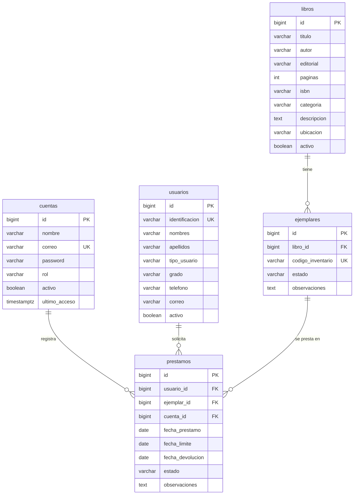

# Modelo de datos

Todas las tablas incluyen `created_at` y `updated_at` (este último se actualiza por trigger). Tabla auxiliar: `intentos_login` (limitación de intentos).

## Reglas en la base de datos
- `cuentas.rol` ∈ {administrador, bibliotecario}; `usuarios.tipo_usuario` ∈ {estudiante, docente, administrativo}.
- `ejemplares.estado` ∈ {disponible, danado, perdido, inactivo}. **No existe estado "prestado"**: se deduce de un préstamo activo.
- `libros.paginas > 0`; `fecha_limite >= fecha_prestamo`; `fecha_devolucion >= fecha_prestamo`; estado `activo` ⇔ sin fecha de devolución.
- Índice único parcial `ux_prestamos_ejemplar_activo (ejemplar_id) WHERE estado='activo'`.
- Todas las claves foráneas son `ON DELETE RESTRICT`: no se borra en cascada el historial.
- Extensión `unaccent` para buscar sin importar tildes.
